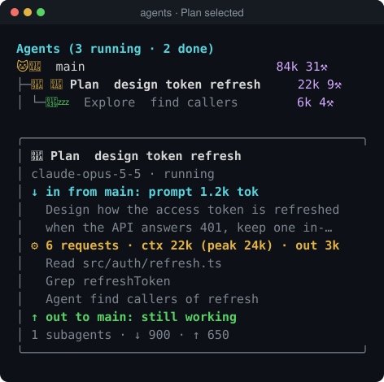

# agent-flow (with pets) 🐱

A Claude Code mod that shows your session's agents live in a side pane. You see the main loop and its context window, every subagent it spawned as a tree, and what each one was handed, did and returned. Every agent is a small animal: its species tells you the model, and its marks tell you whether it is working or done.

<p align="center">
  
</p>

> The images are mockups drawn from the pane's render code. The real pane uses your terminal's font and colours.

Fork of `agent-flow` from [claude-code-templates](https://github.com/davila7/claude-code-templates) (MIT).

---

## Install

At the prompt of a Claude Code terminal session:

```
/plugin install agent-flow --marketplace kongpop1405/agent-flow-pets
```

Answer `y` to add the marketplace, then pick a scope (user = every project, project = this repo only).

From a shell:

```
claude plugin install agent-flow --marketplace kongpop1405/agent-flow-pets
```

Requires Claude Code **2.1.287 or newer**.

## Use

| Command | What it does |
| --- | --- |
| `/agent-flow` | Open the pane and focus it |
| `/agent-flow clear` | Forget finished agents (running ones stay) |
| `/agent-flow stop` | Close the pane |

- In `/tui fullscreen` the pane docks beside the transcript. Otherwise it sits above the prompt.
- The pane opens by itself, without taking focus, the first time a subagent spawns. You can turn that off in the options below.
- Click an agent, or press Tab then Enter, to open its detail box. Select it again to close the box.
- Select **main** to see the session's context broken down by category (press *refresh* if it is empty).

## What the pane shows

### 1. Session header

```
Session · turn 12
context 84k/200k 42%
█████████████████░░░░░░░░░░░░░░░░░░░░░░░
› refactor the auth middleware and add tests
```

The main loop's context in use against the window, a bar that turns yellow above 60% and red above 80%, and the prompt of the current turn.

### 2. Agent tree

Each row shows: pet + status mark, agent type and description, the agent's current context size (magenta), and how many tools it has called (`⚒`). Children sit under the agent that spawned them. Background shells (`run_in_background`) join the tree as 🐢.

### 3. Detail box

<p align="center">
  
</p>

| Line | Meaning |
| --- | --- |
| `↓ in from main: prompt 1.2k tok` | Context handed **down**: the prompt it got. A fork gets the parent's whole context, shown as `its whole context (~84k) + …` |
| `⚙ 6 requests · ctx 22k (peak 24k) · out 3k` | What it **did**: model requests, its own context now and at peak, tokens it wrote |
| last 5 tool calls | Failed calls in red |
| `↑ out to main: answer 650 tok` | What it handed **back up**, with the first lines of the answer |

Token counts for prompts and answers are estimates (4 characters per token). Context sizes come from the engine's own measurements.

### 4. Big pet and legend

The cat under the tree is **awake** while anything is running and **asleep** when nothing is. The legend at the bottom of the pane lists every pet:

<p align="center">
  
</p>

| Pet | Who |
| --- | --- |
| 🐱 | main loop (your conversation) |
| 🐹 | subagent on **Haiku** |
| 🐶 | subagent on **Sonnet** |
| 🦊 | subagent on **Opus** |
| 🐉 | subagent on **Fable** |
| 🐰 | subagent whose model is not known |
| 🐢 | background shell command |

| Mark | Status |
| --- | --- |
| 💨 (moving) | working |
| 💤 | finished. The colour tells you how: **green** done · **red** failed · **gray** stopped |

### 5. Status line

The mod also writes one status line entry, shown whether the pane is open or not:

```
🟢 context 84k/200k 42% · $1.37 · 1h05m │ agents 3 running · 2 done
```

🟢 under 120k tokens, 🟡 from 120k, 🔴 from 250k. The agent counts are added only while the pane is open.

## Token usage: does it cost tokens?

**Almost none.** The mod only watches; it never talks to the model.

- **No model calls.** It never calls the model, starts no agent of its own and registers no tool, so nothing it does is billed.
- **Nothing added to your context.** It does not touch the system prompt, and every hook passes events through unchanged. Your prompts, tool calls and answers reach the model exactly as they would without it.
- **The one exception:** when you type `/agent-flow`, its one-line reply (e.g. `3 agents so far · click an agent, or Tab and Enter · /agent-flow stop closes`) is added to the transcript like any command output. That is about 20–30 tokens per use.
- **The numbers in the pane are readings, not costs.** `84k`, `22k`, `$1.37` show what your session and subagents already used. They do not add to it.

Local cost only: while the pane is open it redraws every 400 ms to animate the pets (it stops when you close the pane), and it keeps the tree in session state so a reload does not lose it.

## Options

Set them in the `/plugin` menu (the mod's config), or in `settings.json` under `pluginConfigs`:

| Option | Default | What it does |
| --- | --- | --- |
| `columns` | `52` | Width asked for the docked pane (32–120). A width you drag it to wins |
| `maxAgents` | `60` | Subagents kept; the oldest finished ones are dropped first |
| `openOnStart` | `false` | Open the pane when the session starts |
| `openOnAgent` | `true` | Open the pane (without focus) when the first subagent spawns |

On terminals narrower than 144 columns the engine keeps a pane you did not ask for hidden; `/agent-flow` always opens it.

## Uninstall

```
/plugin uninstall agent-flow
```

## License

MIT. See [LICENSE](LICENSE).
