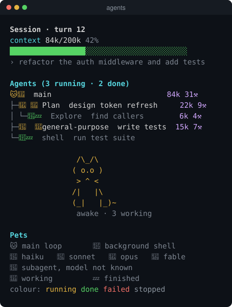
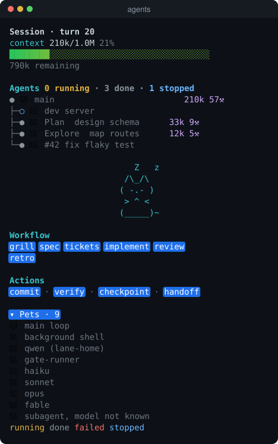

# agent-flow (with pets) 🐱

A Claude Code mod that shows your session's agents live in a side pane. You see the main loop and its context window, every subagent it spawned as a tree, and what each one was handed, did and returned. Every agent is a small animal: its species tells you the model, the mark in front of it tells you its status.

<p align="center">
  
</p>

> The images are mockups drawn from the pane's render code. The real pane uses your editor's or terminal's font and colours.

Fork of `agent-flow` from [claude-code-templates](https://github.com/davila7/claude-code-templates) (MIT).

---

## Install

At the prompt of a Claude Code session:

```
/plugin install agent-flow --marketplace kongpop1405/agent-flow-pets
```

Answer `y` to add the marketplace, then pick a scope (user = every project, project = this repo only).

From a shell:

```
claude plugin install agent-flow --marketplace kongpop1405/agent-flow-pets
```

Requires Claude Code **2.1.287 or newer**.

## Use

| Command | What it does |
| --- | --- |
| `/agent-flow` | Open the pane and focus it |
| `/agent-flow clear` | Forget finished agents (running ones stay) |
| `/agent-flow stop` | Close the pane |

- In `/tui fullscreen` the pane docks beside the transcript. Otherwise it sits above the prompt.
- The pane opens by itself, without taking focus, when the first subagent spawns or a command goes to the background. Both can be turned off (see Options).
- Click an agent, or press Tab then Enter, to open its detail box. Select it again to close it.
- Select **main** to see the session's context broken down by category and the session's tools ranked by time.

## What the pane shows

From top to bottom:

### 1. Session and context

```
Session · turn 12
context 194k/1.0M 19%
███████░░░░░░░░░░░░░░░░░░░░░░░░░░░░░░░░░
806k remaining
```

The main loop's context in use against its window. Each cell of the bar takes the colour of the percentage it stands at, so a fuller bar shows the climb from green through yellow and orange to red.

### 2. Agents

```
Agents 1 running · 5 done · 1 failed
● 🐱 main                       194k 42⚒
├─◐ 🐼 general-purpose  review   61k 12⚒
├─✗ 🐶 Explore  find callers      8k 3⚒
├─● 🐹 clerk  count logs          4k 2⚒
├─● 🐥 pnpm test
└─ 2 more shells done
```

- The header counts agents by status, each in its own colour: running **yellow**, done **gray**, failed **red**, stopped **blue**.
- Each row: status mark, pet, agent type and description, its current context size and how many tools it called (`⚒`).
- Children sit under the agent that spawned them. Among siblings, running ones come first, then failed, stopped and done (newest done first). A finished parent whose child is still running or failed sorts with that child.
- Background shells (`run_in_background`, Bash or PowerShell) join the tree as 🐥. Past three finished shells under one parent, the older ones fold into `N more shells done`. Press it to show them all. Finished agents are never folded.

| Mark | Status |
| --- | --- |
| ◐ | running |
| ● | done |
| ✗ | failed |
| ○ | stopped |

### 3. Detail box

<p align="center">
  
</p>

| Line | Meaning |
| --- | --- |
| `↓ in from main: prompt 1.2k tok` | Context handed **down**: the prompt it got. A fork gets the parent's whole context, shown as `its whole context (~84k) + …` |
| `⚙ 6 requests · ctx 61k (peak 63k) · out 3.1k` | What it **did**: model requests, its own context now and at peak, tokens it wrote |
| last 5 tool calls | With their time; failed calls in red |
| `↑ out to main: answer 650 tok` | What it handed **back up**, with the first lines of the answer |

Token counts for prompts and answers are estimates (4 characters per token). Context sizes come from the engine's own measurements.

### 4. Git

The repos the session edited, ran git in or read from, with their branch on the line below. `(cwd)` marks the session's own folder. The branch is read again after each git command and each turn.

### 5. Compactions

Shown after a `/compact` (or an automatic one): when, what triggered it, and the context before and after.

### 6. Mascot

The free rows between the Git section and the buttons hold one animal per running loop, the same pet the tree shows for it (main is the cat). They hop and blink while working; with nothing running, the cat sleeps with Zs drifting up.

- **Sized to the room:** each pet grows to fill the free rows and shrinks as other sections take them. Many pets wrap onto more rows first, then get smaller; past that the rest are counted as `+N more`.
- **Editor and desktop:** flat coloured SVG, animated by the surface itself.
- **Terminal:** no SVG there, so plain-ASCII art in two sizes (7 rows, then 4), hidden when fewer than 4 rows are free.
- **Hide it:** `hide mascot` beside `▸ Pets` clears the mascot (the rows stay blank); `show mascot` brings it back. It stays hidden across reloads within the session.

### 7. Workflow and Actions

Two rows of buttons at the bottom of the pane:

- **Workflow** (`grill spec tickets implement review retro` by default): a press puts `/name ` in the prompt box for you to finish and send. It does not run anything.
- **Actions** (`commit · verify · checkpoint · handoff` by default): a press runs the command as if you typed it. It waits in the queue until the session is idle.

The defaults are the author's own skills. A button is drawn only when its command exists on your machine (the pane reads the slash-command list when the session starts and when you run `/agent-flow`), and a row with no buttons left is hidden with its heading. To get buttons, set `flowButtons` / `skillButtons` (see [Options](#options)) to commands you have, such as built-ins (`init`, `security-review`) or your own skills. In VS Code every pressable item is drawn as a native button in the editor's button colour; a mod cannot change that colour.

### 8. Pets

Folded by default; press `▸ Pets` to open the legend:

<p align="center">
  
</p>

| Pet | Who |
| --- | --- |
| 🐱 | main loop (your conversation) |
| 🐥 | background shell command |
| 🐨 | qwen |
| 🦉 | lane-home gate-runner |
| 🐹 | subagent on **Haiku** |
| 🐶 | subagent on **Sonnet** |
| 🐼 | subagent on **Opus** |
| 🦄 | subagent on **Fable** |
| 🐰 | subagent whose model is not known |

### Status line

The mod also writes one status line entry, shown whether the pane is open or not:

```
🟢 context 194k/1M 19% · $1.41 · 2h05m │ agents 1 running · 5 done
```

🟢 under 120k tokens, 🟡 from 120k, 🔴 from 250k. The agent counts are added only while the pane is open.

### lane-home runs

If you run a lane-home dispatcher (qwen sessions started outside Claude Code), the pane polls its pid files every 20 seconds through `hooks/lane-home.sh` and shows each run as 🐨, one node per try, so a failed try stays visible after a retry. It reads `$LANE_HOME_RUN` (default `~/.lane-home-run`). Without that folder the script exits quietly and nothing is shown.

## Token usage: does it cost tokens?

**Almost none.** The mod only watches; it never talks to the model.

- **No model calls.** It never calls the model, starts no agent of its own and registers no tool, so nothing it does is billed.
- **Nothing added to your context.** It does not touch the system prompt, and every hook passes events through unchanged.
- **The exceptions:** typing `/agent-flow` adds its one-line reply to the transcript (about 20–30 tokens). An **Actions** button runs a command as if you typed it, so that command's turn costs what it would cost typed.
- **The numbers in the pane are readings, not costs.** They show what your session and subagents already used.

Local cost only: while the pane is open it redraws every 400 ms to animate the terminal mascots, it runs `git` to read branches, and it polls `lane-home.sh` every 20 seconds. The tree is kept in session state so a reload does not lose it.

## Options

Set them in the `/plugin` menu (the mod's config), or in `settings.json` under `pluginConfigs`:

| Option | Default | What it does |
| --- | --- | --- |
| `columns` | `52` | Width asked for the docked pane (32–120). A width you drag it to wins |
| `maxAgents` | `60` | Subagents kept; the oldest finished ones are dropped first |
| `openOnStart` | `false` | Open the pane when the session starts |
| `openOnAgent` | `true` | Open the pane (without focus) when a subagent spawns |
| `openOnBackground` | `true` | Open the pane (without focus) when a command goes to the background or a lane-home run starts |
| `flowButtons` | `grill-with-docs,to-spec,to-tickets,implement,code-review,retro` | Commands on the Workflow row; a press fills the prompt box. `""` hides the row |
| `skillButtons` | `commit,verify-code,checkpoint,handoff-status` | Commands on the Actions row; a press runs them. `""` hides the row |

On terminals narrower than 144 columns the engine keeps a pane you did not ask for hidden; `/agent-flow` always opens it.

## Uninstall

```
/plugin uninstall agent-flow
```

## License

MIT. See [LICENSE](LICENSE).
